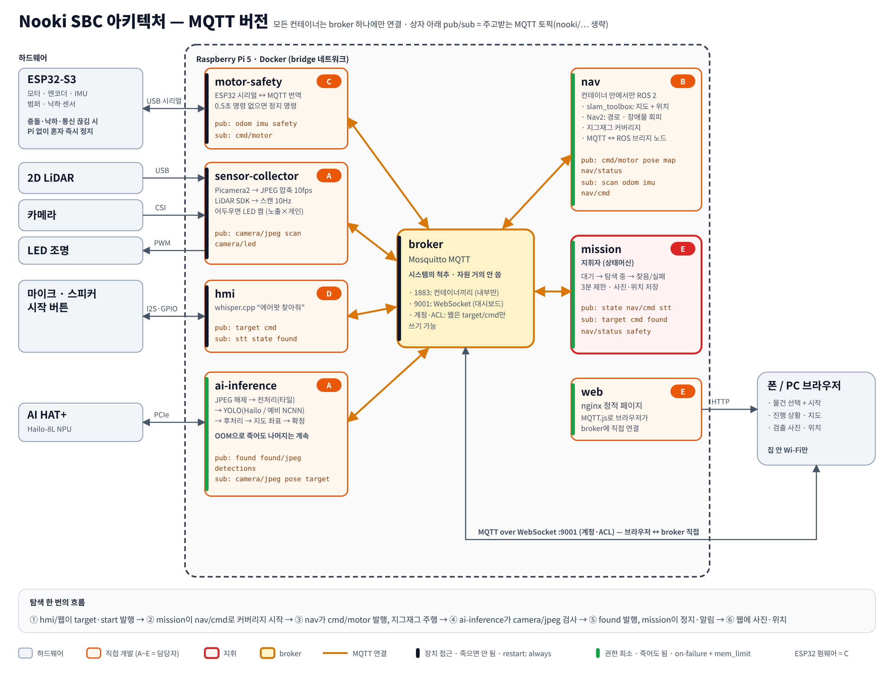

# Nooki SBC 시스템 디자인 — MQTT 버전 (초안 v0, 2026-10-16)

ROS 2 버전(`DESIGN.md`)과 같은 기능을 **MQTT broker 하나를 척추로** 구성한 대안. 하드웨어·KPI·ESP32 안전 규칙은 `DESIGN.md`와 같다. 구조는 강의 자료(`~/Downloads/image.png`)의 sensor-collector / motor-safety-control / broker / ai-inference 패턴을 따른다. MQTT 기본 사용법은 `code/mqtt/` 실습 참고.



원본: `architecture_mqtt.svg` (PNG 재생성: `google-chrome --headless=new --window-size=1440,1090 --force-device-scale-factor=2 --screenshot=$PWD/architecture_mqtt.png file://$PWD/architecture_mqtt.svg`)

## 1. 원칙

1. 컨테이너끼리 직접 연결하지 않는다. **모두 broker에만 붙는다**(`BROKER=broker:1883`).
2. 계층: 장치 접근 + 죽으면 안 됨(`motor-safety`, `sensor-collector`, `hmi`, `broker`) → `restart: always`. 권한 최소 + 죽어도 됨(`ai-inference`, `nav`, `mission`, `web`) → `restart: on-failure` + `mem_limit`.
3. 페이로드: 제어·상태는 JSON, 영상은 JPEG 바이너리. 타임스탬프는 MQTT v5 user property `ts`(epoch 초, float).
4. SLAM·Nav2는 ROS 2 없이 대체품이 없어서 **nav 컨테이너 안에서만 ROS 2를 돌리고**, 브리지 노드가 MQTT와 번역한다. 다른 컨테이너는 ROS를 모른다.
5. Docker 기본 bridge 네트워크. 밖으로 여는 포트는 `broker:9001`(WebSocket)과 `web:8080`뿐.

## 2. 컨테이너

| 컨테이너 | 계층 | 하는 일 | 장치 | 담당 |
|---|---|---|---|---|
| `broker` | 척추 | Mosquitto. 1883 내부, 9001 WebSocket(계정·ACL) | 없음 | E |
| `motor-safety` | 장치 | ESP32 시리얼 ↔ MQTT 번역. `cmd/motor`가 0.5초 끊기면 정지 명령 | `/dev/ttyACM0` | C |
| `sensor-collector` | 장치 | Picamera2 → JPEG, LiDAR 스캔, LED 제어 | 카메라 일체, `/dev/ttyUSB0`, `/dev/gpiochip*` | A |
| `hmi` | 장치 | whisper.cpp STT, 알림음, 시작 버튼 | `/dev/snd`, `/dev/gpiochip*` | D |
| `ai-inference` | 소프트웨어 | JPEG 해제 → 전처리 → Hailo/NCNN → 후처리 → 지도 좌표 → 확정 | `/dev/hailo0` | A |
| `nav` | 소프트웨어 | 내부 ROS 2: slam_toolbox, Nav2, 커버리지 + MQTT 브리지 | 없음 | B |
| `mission` | 소프트웨어 | 상태머신(대기→탐색→찾음/실패), 3분 제한, 저장 | 볼륨 `./data` | E |
| `web` | 소프트웨어 | nginx 정적 페이지. 브라우저가 MQTT.js로 broker:9001 직접 연결 | 없음 | E |

ESP32 펌웨어(C)는 micro-ROS 대신 **단순 시리얼 프로토콜**(JSON 한 줄 또는 고정 길이 바이너리, 921600bps)로 바뀐다.

## 3. 토픽 계약 (`nooki/` 접두어)

| 토픽 | 페이로드 | 발행 → 구독 | QoS / retain | 주기 |
|---|---|---|---|---|
| `odom` | `{"x","y","th","vx","wz"}` (odom 좌표) | motor-safety → nav | 0 | 50 Hz |
| `imu` | `{"ax","ay","az","gx","gy","gz"}` | motor-safety → nav | 0 | 50 Hz |
| `safety` | `{"bumper":[l,r],"cliff":[4개],"estop":bool}` | motor-safety → mission, web | 1 / retain | 변할 때 |
| `cmd/motor` | `{"v":m/s,"w":rad/s}` | nav → motor-safety | 0 | 20 Hz |
| `scan` | `{"angle_min","angle_inc","ranges":[...]}` | sensor-collector → nav | 0 | 10 Hz |
| `camera/jpeg` | JPEG 1280×720 | sensor-collector → ai-inference | 0 | 10 Hz |
| `camera/led` | `{"on":bool}` | sensor-collector → ai-inference | 1 / retain | 변할 때 |
| `pose` | `{"x","y","th"}` (map 좌표) | nav → ai-inference, web | 0 | 20 Hz |
| `map/png`, `map/info` | PNG / `{"res","origin":[x,y]}` | nav → web | 1 / retain | 1 Hz |
| `nav/cmd` | `{"action":"coverage","size_m":4}` / `{"action":"cancel"}` | mission → nav | 1 | 이벤트 |
| `nav/status` | `{"state":"running\|done\|failed","progress":0~1}` | nav → mission, web | 1 / retain | 1 Hz |
| `target` | `"airpods"` 등 클래스 이름 | hmi, web → mission, ai-inference | 1 / retain | 이벤트 |
| `cmd` | `"start"` / `"stop"` | hmi, web → mission | 1 | 이벤트 |
| `state` | `"IDLE\|SEARCHING\|FOUND\|FAILED"` | mission → 전체 | 1 / retain | 변할 때 |
| `stt` | `{"enable":bool}` | mission → hmi | 1 / retain | 변할 때 |
| `detections` | `[{"cls","conf","box":[x1,y1,x2,y2]}]` | ai-inference → web | 0 | 프레임별 (디버그) |
| `found` | `{"cls","conf","x","y"}` (map 좌표) | ai-inference → mission, hmi, web | 1 | 확정 시 |
| `found/jpeg` | JPEG (박스 그림) | ai-inference → mission, web | 1 / retain | 확정 시 |

- 픽셀 → 지도 변환: ai-inference가 `pose`를 최근 1초 보관하고, 영상의 `ts`와 가장 가까운 pose를 고른다. 카메라 장착 높이·각도는 ai-inference 설정 파일 한 곳에만 둔다(ROS 버전의 TF 대신).
- ACL: 웹 계정은 `target`, `cmd` **쓰기만** 허용하고 `state`, `found*`, `map/*`, `pose`, `nav/status`, `safety`, `detections`는 읽기만 한다. `cmd/motor` 쓰기는 nav 계정만 허용한다.

## 4. compose 골격

```yaml
x-hw: &hw { restart: always, environment: { BROKER: broker } , depends_on: [broker] }
x-sw: &sw { restart: on-failure, mem_limit: 1g, environment: { BROKER: broker }, depends_on: [broker] }

services:
  broker:           { image: eclipse-mosquitto:2, restart: always, ports: ["9001:9001"],
                      volumes: [./broker:/mosquitto/config:ro] }   # mosquitto.conf, passwd, acl
  motor-safety:     { <<: *hw, build: ./motor-safety, devices: [/dev/ttyACM0] }
  sensor-collector: { <<: *hw, build: ./sensor-collector, privileged: true, volumes: [/run/udev:/run/udev:ro] }
  hmi:              { <<: *hw, build: ./hmi, devices: [/dev/snd, /dev/gpiochip0] }
  ai-inference:     { <<: *sw, build: ./ai-inference, devices: [/dev/hailo0], mem_limit: 2g }
  nav:              { <<: *sw, build: ./nav }          # FROM ros:jazzy-ros-base + paho-mqtt
  mission:          { <<: *sw, build: ./mission, mem_limit: 256m, volumes: [./data:/data] }
  web:              { image: nginx:alpine, restart: on-failure, mem_limit: 64m,
                      ports: ["8080:80"], volumes: [./web:/usr/share/nginx/html:ro] }
```

## 5. 리스크 (MQTT 버전에만 있는 것)

1. **nav 브리지가 제일 크다.** `scan`/`odom`/`imu` JSON → `LaserScan`/`Odometry`/`Imu` + TF 브로드캐스트, `cmd_vel` → `cmd/motor`, `/map` → PNG, 커버리지 액션 래핑까지 B가 전부 작성해야 한다. 타임스탬프가 어긋나면 SLAM이 바로 틀어진다.
2. 시간 동기화: ROS의 TF·메시지 헤더가 해주던 일을 `ts` + pose 버퍼로 직접 한다.
3. 영상: JPEG 인코딩(sensor-collector)·디코딩(ai-inference)에 프레임당 수 ms CPU. 화질 손실이 작은 물체 검출에 주는 영향 확인 필요(quality 90 이상 권장).
4. 녹화·재생·시각화 도구(rosbag, rviz)가 없다. 대신 `mosquitto_sub -v -t 'nooki/#'` 로깅 스크립트를 따로 만들어야 한다.
5. LiDAR C1 드라이버를 ROS 없이 쓰려면 Slamtec C++ SDK를 직접 감싸야 한다(ROS 버전은 `sllidar_ros2` 그대로).

## 6. ROS 2 버전과 비교

| | ROS 2 버전 (`DESIGN.md`) | MQTT 버전 (이 문서) |
|---|---|---|
| SLAM·Nav2·TF | 그대로 사용 | nav 안에 가두고 브리지 직접 작성 |
| ESP32 연결 | micro-ROS (기성 agent) | 직접 만든 시리얼 프로토콜 |
| LiDAR | `sllidar_ros2` 기성 | C++ SDK 직접 |
| 웹 대시보드 | rosbridge + roslibjs | broker WebSocket + MQTT.js (더 단순) |
| 컨테이너 격리 | host 네트워크 공유 | bridge 네트워크, 포트 최소 |
| 디버깅 도구 | rosbag, rviz, `ros2 topic` | `mosquitto_sub`, 직접 작성 |
| 배우기 | 어렵다 | 쉽다 |
| 새로 쓸 코드 | 적다 | 많다 (브리지·프로토콜·드라이버·로깅) |
