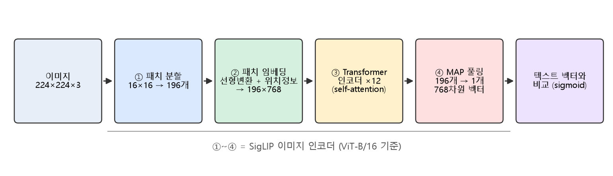
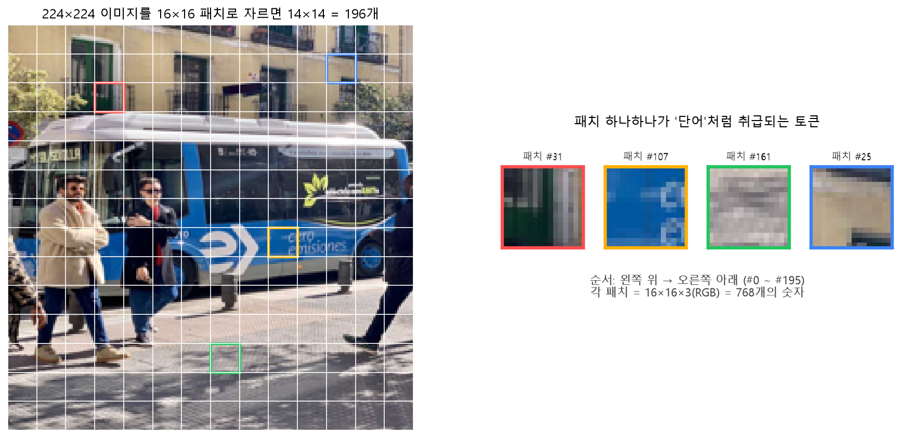
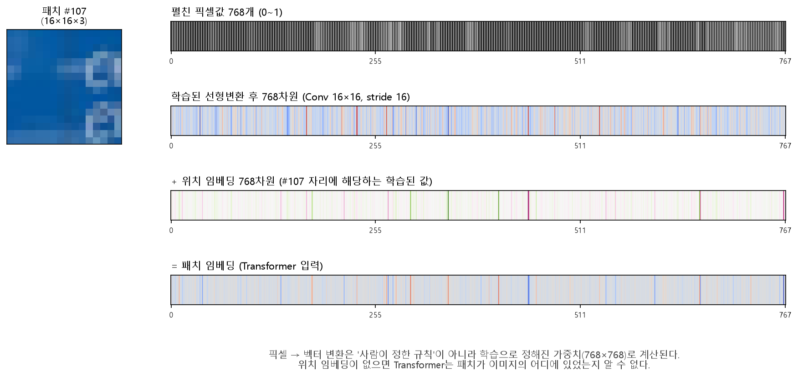
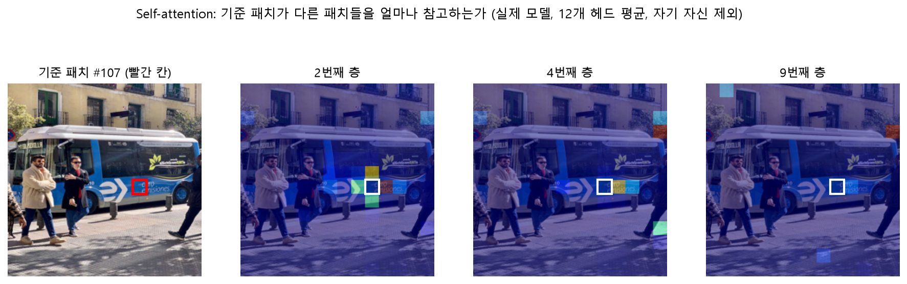
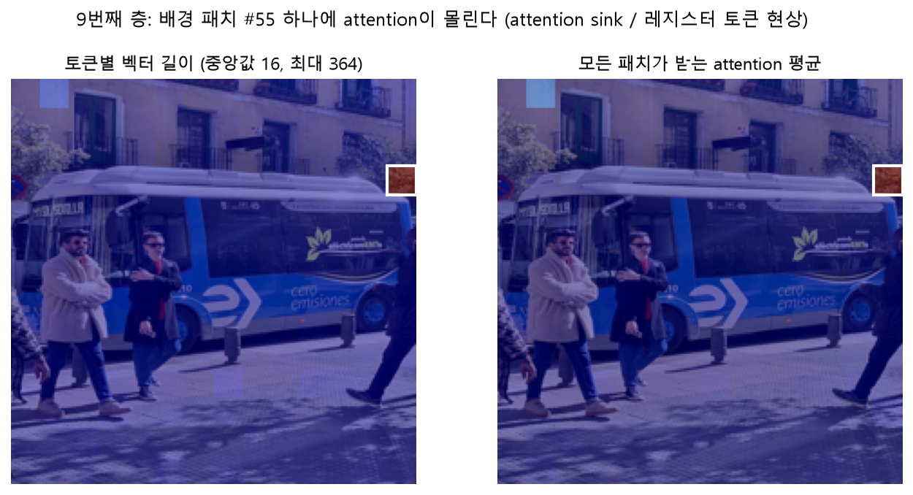
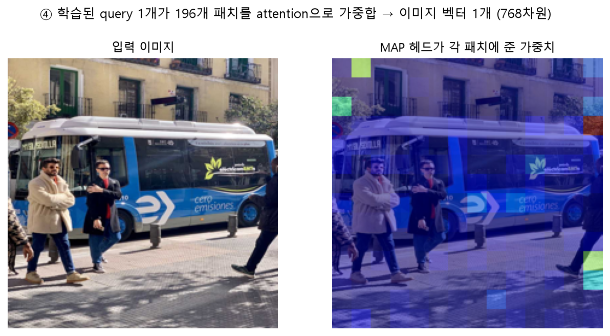
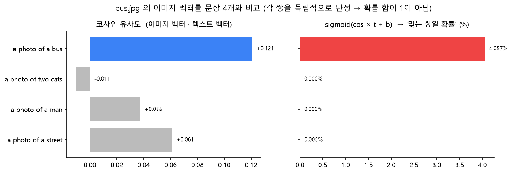

# SigLIP 이미지 인코더 스터디 노트 — 사진이 768차원 벡터가 되기까지

> 그림은 모두 이 폴더의 실습 모델 `google/siglip2-base-patch16-224`에 `bus.jpg`를 넣어서 만들었어요.
> 실제 모델 내부 값을 그린 것이라 직접 다시 만들어 볼 수 있어요. (`py siglip2\docs\make_figures.py`, `test` 폴더에서 실행)

---

## 0. 원래 설명 검증 결과

**결론: 큰 흐름은 맞아요.** 다만 빠진 부분 2가지(위치 임베딩, MAP 풀링)와 다듬을 표현이 있어서 아래처럼 보완했어요.

| 원래 설명 | 판정 | 보완할 내용 |
|---|---|---|
| ViT(Vision Transformer)를 사용 | ✅ 맞음 | SigLIP, SigLIP 2 모두 이미지 쪽은 ViT예요. 실습 모델은 ViT-B/16 (12층, 768차원) |
| 1. 16×16 패치로 나눔, 크기는 모델마다 다름 | ✅ 맞음 | 예: `base-patch16-224`는 16×16, `so400m-patch14-384`는 14×14. 224×224 입력이면 14×14 = **196개** 패치 |
| 2. 학습된 변환으로 픽셀 → 초기 벡터 | ✅ 맞음, 보완 필요 | 실제로는 16×16×3 = 768개 픽셀값에 **선형변환**(코드상 `Conv2d(3, 768, kernel=16, stride=16)`)을 하고, **위치 임베딩**을 더해요. 위치 정보가 없으면 패치가 어디 있었는지 모릅니다 |
| 3. 패치끼리 참고하며 벡터 갱신 | ✅ 맞음 | 이게 **self-attention**이에요. 이 과정을 12번(12층) 반복해요 |
| 4. 패치 정보를 모아 대표 벡터 생성 | ✅ 맞음, 보완 필요 | SigLIP은 CLS 토큰이나 단순 평균이 아니라 **MAP(Multihead Attention Pooling) 헤드**로 모아요. 학습된 질의(query) 1개가 196개 패치를 attention으로 가중합해요 |
| 텍스트 벡터와 비교 | ✅ 맞음 | 두 벡터를 길이 1로 정규화 → 내적(코사인 유사도) → `× t + b` → **sigmoid**. 각 (이미지, 문장) 쌍을 독립적으로 "맞다/아니다" 판정해요 |
| 논문 링크 | ✅ 맞음 | Zhai et al., *Sigmoid Loss for Language Image Pre-Training*, ICCV 2023 |
| 최종 벡터는 학습된 특징, 사람이 "귀/눈"을 지정하지 않음 | ✅ 맞음 | 아래 5장의 *attention sink*가 좋은 증거예요. 모델이 스스로 배경 패치를 '메모장'처럼 쓰기도 해요 |

한 줄 요약에 넣을 표현을 조금 다듬는다면:

> **"형태, 질감, 물체와 배경 등의 정보를 학습합니다"** → 학습은 사전학습 때 이미 끝났어요. 추론할 때는 *학습된 가중치로 정보를 섞는다*가 더 정확해요.

---

## 1. 전체 흐름



| 단계 | 텐서 모양 | 하는 일 |
|---|---|---|
| 입력 | 3 × 224 × 224 | 프로세서가 224×224로 리사이즈하고 픽셀을 -1~1로 정규화 |
| ① 패치 분할 | 196 × (16·16·3) | 이미지를 겹치지 않게 16×16으로 자름 |
| ② 패치 임베딩 | 196 × 768 | 선형변환 + 위치 임베딩 |
| ③ Transformer ×12 | 196 × 768 | self-attention + MLP를 12번 반복 (모양은 그대로, 내용만 바뀜) |
| ④ MAP 풀링 | 1 × 768 | 196개를 하나로 요약 → **이미지 임베딩** |

텍스트도 별도의 Transformer(텍스트 인코더)를 거쳐 **같은 768차원**이 돼요. 그래서 바로 비교할 수 있어요.

---

## 2. ① 패치 분할 — 이미지를 '단어'로 자르기



- Transformer는 원래 **문장(단어 시퀀스)** 을 처리하던 구조예요.
- ViT의 아이디어는 "이미지를 조각내면 조각 하나가 단어 하나"라는 것이에요. 그래서 ViT 논문 제목이 *An Image is Worth 16x16 Words*예요.
- 패치 하나는 16 × 16 × 3(RGB) = **768개의 숫자**예요.
- 이 단계는 학습과 무관한 단순한 자르기예요.

> 💡 패치를 작게 자르면(14×14 등) 세밀해지지만, 패치 수가 늘어서 계산량이 커져요. self-attention 계산량은 패치 수의 제곱에 비례해요.

---

## 3. ② 패치 임베딩 — 픽셀을 벡터로



위 그림은 실제 패치 #107(버스 로고 부분)이 변하는 과정이에요.

1. **펼치기**: 16×16×3 패치를 768개 숫자 한 줄로 펼쳐요.
2. **선형변환**: 학습된 768×768 가중치 행렬을 곱해 새로운 768차원 벡터로 바꿔요.
   - 코드에서는 `Conv2d(kernel=16, stride=16)`로 구현돼 있어요. 커널 크기와 보폭이 패치 크기와 같으면, 패치마다 같은 행렬을 곱하는 것과 수학적으로 같아요.
3. **위치 임베딩 더하기**: 196개 자리마다 학습된 768차원 벡터가 하나씩 있어서, 패치 번호에 맞는 것을 더해요.

**왜 위치 임베딩이 필요할까요?**
self-attention은 입력 순서를 섞어도 결과가 똑같이 섞일 뿐이라서, 그 자체로는 순서를 몰라요. "하늘 패치가 위에 있고 도로 패치가 아래에 있다"는 정보를 위치 임베딩이 알려줘요.

> 이 단계의 벡터는 아직 "이 16×16 조각의 색과 무늬"에 가까워요. '버스'라는 의미는 아직 없어요.

---

## 4. ③ Transformer 인코더 — 패치끼리 정보 주고받기

각 층에서 패치 벡터마다 다음 일이 일어나요.

```
1) 내 벡터로 Query(찾는 것), Key(내가 가진 것), Value(전달할 내용)를 만든다
2) 내 Query와 다른 모든 패치의 Key를 비교해 "누구를 얼마나 볼지" 점수를 낸다  (softmax → 합 1)
3) 그 점수로 다른 패치들의 Value를 가중합해서 내 벡터에 더한다
4) MLP로 한 번 더 가공한다
```

이걸 196개 패치가 **동시에** 하고, 12층에 걸쳐 반복해요. 층이 깊어질수록 각 패치 벡터에는 주변과 이미지 전체의 정보가 섞여 들어가요.



실제 모델에서 패치 #107(빨간 칸)이 다른 패치를 얼마나 참고하는지 그린 그림이에요.

- **2번째 층**: 바로 옆 패치들(버스 로고의 화살표, 위아래 차체)을 주로 봐요. 얕은 층은 **가까운 곳의 모양·질감**을 다뤄요.
- **4번째 층**: 오른쪽 가장자리 배경 패치 몇 개로 시선이 옮겨가기 시작해요.
- **9번째 층**: 오른쪽 배경 패치 하나에 거의 몰려 있어요. 다음 장에서 설명하는 *attention sink* 현상이에요.

> ⚠️ attention 지도는 "모델이 어떻게 생각하는지"를 보여주는 힌트일 뿐 정답 설명은 아니에요. 12개 헤드를 평균 내면 헤드마다 다른 역할이 뭉개지기도 해요.

---

## 5. 덤: attention sink — 사람이 지정하지 않았다는 증거



- 9번째 층에서 배경 패치 #55의 벡터 길이는 **약 364**예요. 나머지 패치의 중앙값은 **약 16**이에요.
- 그리고 대부분의 패치가 이 패치에 attention을 몰아줘요.
- 그런데 #55는 건물 벽 구석일 뿐, 중요한 물체가 아니에요.

이건 큰 ViT에서 흔히 관찰되는 현상이에요. 모델이 **정보가 적은 배경 패치를 전역 정보 저장소처럼 재활용**하는 거예요. *Vision Transformers Need Registers* 논문에서는 이런 토큰을 위해 아예 빈 '레지스터 토큰'을 추가하자고 제안했어요.

원래 설명의 마지막 문장과 정확히 연결돼요.
> 사람이 "이 패치는 귀, 저 패치는 눈"이라고 정하지 않아요. 모델은 학습 목표(텍스트와 맞추기)를 잘 해내는 방법을 **스스로** 찾고, 그 방법은 사람의 직관과 다를 수 있어요.

---

## 6. ④ MAP 풀링 — 196개를 1개로



ViT 계열이 196개 패치 벡터를 하나로 모으는 방법은 크게 세 가지예요.

| 방법 | 설명 | 사용 모델 |
|---|---|---|
| CLS 토큰 | 맨 앞에 특별 토큰을 하나 더 넣고, 마지막 층의 그 토큰을 대표로 씀 | 원래 ViT, CLIP |
| 평균 풀링 | 196개 벡터를 단순 평균 | 일부 ViT |
| **MAP 헤드** | **학습된 query 1개**가 196개 패치에 attention을 해서 가중합 → LayerNorm → MLP | **SigLIP, SigLIP 2** |

MAP는 "어떤 패치를 얼마나 반영할지"까지 학습해요. 위 그림을 보면 가중치가 버스 위가 아니라 **배경 패치들(sink)** 에 몰려 있어요. 12층을 지나는 동안 버스에 대한 정보가 이미 그 패치들로 옮겨져 있어서, 거기서 읽어 오는 거예요.

> 즉, "MAP가 높게 본 곳 = 물체가 있는 곳"이 아니에요. 물체 위치를 보고 싶다면 attention이 아니라 Grad-CAM 같은 다른 방법이 필요해요.

---

## 7. 텍스트 벡터와 비교 — sigmoid로 쌍마다 판정



```
cos  = normalize(이미지 벡터) · normalize(텍스트 벡터)      # -1 ~ 1
prob = sigmoid(cos × t + b)                                 # t = exp(logit_scale), b = logit_bias (학습된 값)
```

- `a photo of a bus`가 코사인 **+0.121**로 1등이에요. sigmoid 확률은 **4.1%** 로 낮지만 정상이에요.
  - SigLIP의 `b`는 큰 음수라서, 확실한 쌍이 아니면 낮게 판정하도록 학습됐어요.
- `a photo of a street`(+0.061)가 2등인 것도 자연스러워요. 실제로 길거리 사진이니까요.
- **CLIP(softmax)** 은 "4개 중 정답 하나"를 골라 확률 합이 1이에요.
- **SigLIP(sigmoid)** 은 쌍마다 "예/아니오"를 따로 판정해서 확률 합이 1일 필요가 없어요.

학습 때도 같은 방식이에요. 배치 안의 모든 (이미지, 문장) 조합에 대해 "짝이면 1, 아니면 0"을 맞히는 이진 분류 손실을 써요. 이 덕분에 배치 전체를 모아 softmax 정규화를 할 필요가 없어서 큰 배치로 효율적으로 학습할 수 있어요. 이게 SigLIP 논문의 핵심이에요.

---

## 8. SigLIP vs SigLIP 2 (이 폴더의 모델)

이미지 인코더 구조(ViT + MAP 헤드)는 같고, **학습 방법**이 달라졌어요.

| | SigLIP | SigLIP 2 |
|---|---|---|
| 이미지 인코더 | ViT + MAP | ViT + MAP (동일) |
| 학습 목표 | sigmoid 이미지-텍스트 손실 | sigmoid 손실 + 캡션 생성/위치 맞히기(LocCa) + 자기 증류 + 마스크 예측 |
| 언어 | 주로 영어 | 다국어 (그래서 한국어도 어느 정도 동작) |
| 해상도 | 고정 정사각형 | 고정 버전 + **NaFlex** 버전(원래 종횡비 유지, 패치 수 가변) |
| 강점 | zero-shot 분류, 검색 | + 위치 파악, 밀집 특징(dense feature)이 더 좋아짐 |

> 실습 모델 `siglip2-base-patch16-224`는 고정 해상도 버전이에요. 그래서 버스 사진(가로로 긴 사진)이 224×224 정사각형으로 **찌그러져** 들어가요. 위 그림의 사진이 살짝 눌려 보이는 이유예요.

---

## 9. 한 장 요약

```
사진 ─▶ 16×16으로 자르기 (196조각)
     ─▶ 조각마다 학습된 선형변환 + 위치 임베딩 (196 × 768)
     ─▶ self-attention 12층: 조각들이 서로 정보를 주고받음 (196 × 768)
     ─▶ MAP 헤드: 학습된 query가 196개를 가중합 (1 × 768)  ← 이미지 임베딩
     ─▶ 텍스트 임베딩과 코사인 유사도 → × t + b → sigmoid
```

- 처음 벡터는 **픽셀의 선형변환**이지만, 최종 벡터는 **학습된 의미 표현**이에요.
- 무엇을 어디에 저장할지는 사람이 아니라 학습이 정해요. (예: attention sink)

---

## 10. 확인 문제

1. 384×384 이미지를 14×14 패치로 자르면 패치는 몇 개일까요?
2. 위치 임베딩을 빼고 196개 패치의 순서를 무작위로 섞어서 넣으면 최종 이미지 벡터가 바뀔까요?
3. CLIP과 SigLIP에서 한 이미지에 대한 문장 확률의 합은 각각 어떻게 될까요?
4. MAP 헤드가 배경 패치에 높은 가중치를 준다면, 모델이 배경만 보고 판단한다는 뜻일까요?

<details>
<summary>정답 보기</summary>

1. 384 / 14 ≈ 27.4라서 나누어떨어지지 않아요. 실제 `so400m-patch14-384`는 27×27 = **729개**를 써요. (끝의 6픽셀은 Conv의 `padding="valid"`로 버려져요)
2. 바뀌지 않아요. self-attention과 MAP 풀링은 입력 순서와 무관한 연산이라서, 위치 임베딩이 없으면 '조각 퍼즐을 흩어 놓은 것'과 '완성된 그림'을 구분하지 못해요. 그래서 위치 임베딩이 꼭 필요해요.
3. CLIP은 softmax라서 항상 1이에요. SigLIP은 sigmoid라서 1이 아니어도 돼요.
4. 아니에요. 12층을 거치며 물체 정보가 sink 패치로 옮겨졌기 때문에, MAP는 그 '저장소'를 읽는 것일 수 있어요. attention 위치 ≠ 판단 근거예요.

</details>

---

## 참고 자료

- [SigLIP 논문 — Sigmoid Loss for Language Image Pre-Training (ICCV 2023)](https://openaccess.thecvf.com/content/ICCV2023/papers/Zhai_Sigmoid_Loss_for_Language_Image_Pre-Training_ICCV_2023_paper.pdf)
- [SigLIP 2 논문 — Multilingual Vision-Language Encoders with Improved Semantic Understanding, Localization, and Dense Features](https://arxiv.org/abs/2502.14786)
- [ViT 논문 — An Image is Worth 16x16 Words](https://arxiv.org/abs/2010.11929)
- [Vision Transformers Need Registers (attention sink 현상)](https://arxiv.org/abs/2309.16588)
- 실습: [../README.md](../README.md), [../siglip2_practice.py](../siglip2_practice.py)
